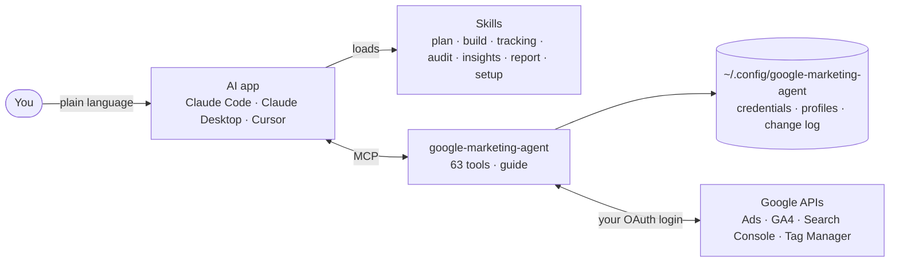
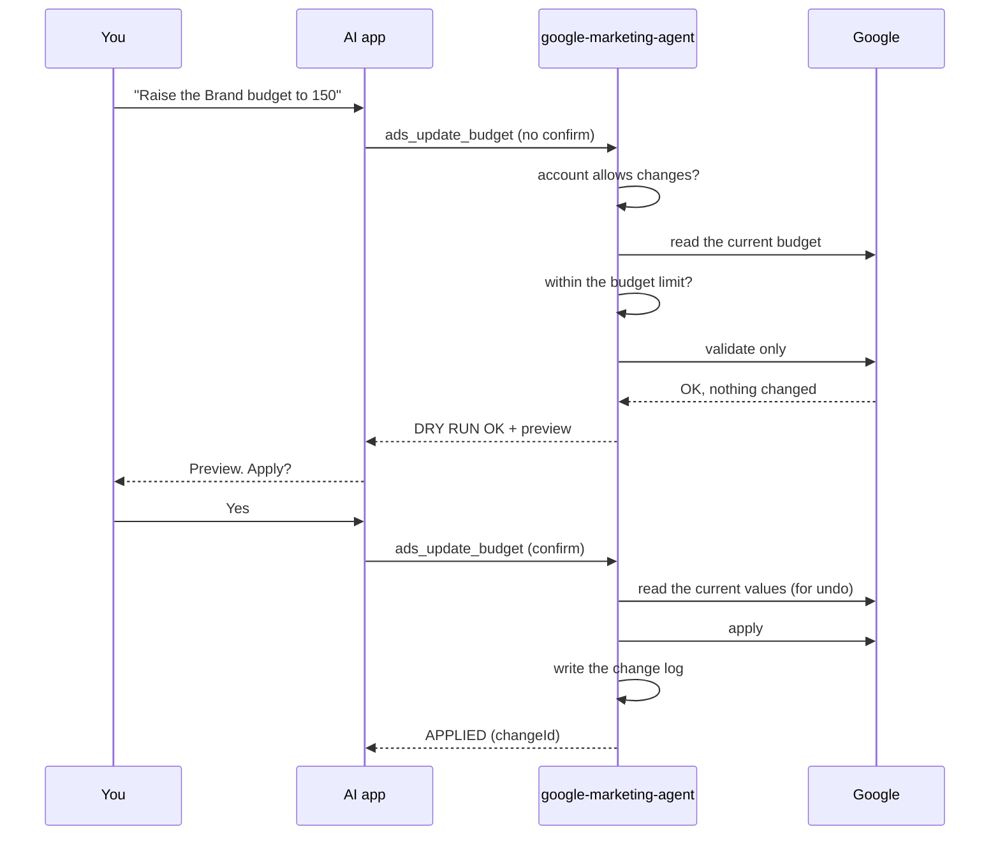

# How it works

google-marketing-agent is a small program that runs **on your computer**. Your AI app starts it, asks it for data or
changes, and it talks to Google's APIs with your own login. There is no server in between.

## The parts

| Part | Role |
|---|---|
| **AI app** | Understands your question, picks a skill, calls tools, writes the answer |
| **Skills** | Step-by-step workflows (what to check, in which order, what good looks like, when to stop and ask you). They ship with the Claude Code plugin |
| **MCP server** | The tools: reports, GAQL, changes, setup checks. Also serves the `guide` knowledge topics the skills rely on |
| **Profiles** | One per account: IDs, currency, linked GA4/Search Console/Tag Manager, whether changes are allowed |
| **Change log** | Every applied change with the values before it, so it can be undone |
| **Google APIs** | Called directly with your OAuth client, at your Cloud project's access level |

## What happens when you ask for a change

If any check fails, nothing is sent to Google. If the current values can't be read, the change is refused, so an update
is never applied without the values needed to undo it.

## Where your data lives

| What | Where | Who can read it |
|---|---|---|
| OAuth client and sign-in | `~/.config/google-marketing-agent/credentials.json` | Only your user account (file mode 600). Never shown to the AI |
| Profiles | `~/.config/google-marketing-agent/accounts.json` | Only your user account |
| Change log | `~/.config/google-marketing-agent/changes/<alias>.jsonl` | Only your user account |
| Report results | Sent to your AI app when you ask | Your AI app, under its own data policy |
| Generated reports | `reports/` in the folder your AI app works in | You |

The package sends nothing anywhere except Google's APIs. It has no telemetry and no account of its own.

## Access and limits

- **Google sign-in:** your own OAuth client in your own Google Cloud project ([setup, part 1](setup.md#part-1-google-cloud-once)).
- **Google Ads API access level** belongs to that Cloud project. Explorer allows 2,880 operations a day on real
  accounts, enough for one person or a small agency.
- **Permissions** are whatever the signed-in Google account has in each product. The package can't see or do more
  than you could in the Google interfaces.
