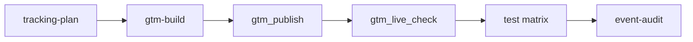

# Tracking

Set up lead tracking in Tag Manager, GA4 and Google Ads, or fix what's there, without hand-writing tag JSON.

1. **Plan:** the agent interviews you once and writes what to track, the code your developers add, and the build order.
2. **Build:** each variable, trigger and tag is created from a typed recipe in the Tag Manager workspace, previewed first.
3. **Publish:** you see the full workspace diff, say yes, and it goes live. The rollback version is noted.
4. **Verify:** the agent checks the live `gtm.js`, then you run a short test matrix.



- [Before you start](#before-you-start)
- [Walkthrough](#walkthrough)
- [Recipe reference](#recipe-reference)
- [Verify](#verify)
- [Rollback](#rollback)
- [Troubleshooting](#troubleshooting)

## Before you start

| You need | How |
|---|---|
| The container and property in the profile | `npx google-marketing-agent accounts set acme gtmContainerId GTM-XXXX` and `npx google-marketing-agent accounts set acme ga4PropertyId 123456789` |
| Tag Manager API and Google Analytics Admin API enabled | Cloud project → APIs & Services → Library ([setup, part 1.2](setup.md#12-enable-the-apis)) |
| Permission to change them | Tag Manager **Publish**, GA4 **Editor**, for your login or a [service account](setup.md#alternative-service-account-for-tag-manager-and-ga4-admin) |
| Changes allowed on the account | `npx google-marketing-agent accounts set acme writes true`, then restart your AI app |

**✅ Check:** *"Run the setup doctor"*. The GA4 and Tag Manager lines for the account are ✓.

Without writes you still get the plan, the audits and the exact recipes to build; nothing is changed.

## Walkthrough

The example: Acme has business pages under `/business/` and consumer pages under `/consumer/`. Leads come from a
contact form and WhatsApp links.

### 1. Plan

```text
You:    Plan lead tracking for example.com.
```

The `tracking-plan` skill asks its questions once, all together: what a lead is worth, which forms and links bring
leads, how pages separate audiences, which regions need consent. Then it reads the container, GA4 and Ads, so the
plan reuses what exists.

**You get** one plan document:

| Section | What's in it |
|---|---|
| Event matrix | Event · fires on · audience split · GA4 key event? · Ads action (counting) · custom goal |
| Data-layer contract | The exact `dataLayer.push` per event for your developers, pushed only when the server confirms the lead |
| Custom dimensions | Event parameters to register in GA4 (`form_name`, `lead_type`…) |
| Ads actions and goals | Actions to create, reuse or make secondary; one custom goal per audience |
| Consent | Which consent types each tag needs |
| Naming and build order | `DLV - form_name`, `CE - generate_lead - Business`, `GA4 Event - generate_lead`… |

The contract sends `value` and `currency` only when the site knows a real value for the lead. Otherwise they are left
out and the Ads action's default value applies: a tag-sent `0` would record every conversion as worthless.

Link clicks (WhatsApp, `tel:`, `mailto:`) need no site code. Form leads need the developers' `dataLayer.push` live
before the build is tested.

### 2. Build

```text
You:    Build the tracking plan.
```

The `gtm-build` skill works in order and shows a preview before each change:

1. **Baseline.** Live version noted as the rollback target. Unexplained unpublished changes stop the build.
   It also checks for a **Conversion Linker** tag on All Pages: without it, Ads conversions from Safari are lost.
   If Ads conversion tags exist or will be built and there is none, it proposes one.
2. **Prerequisites.** Built-in variables (`Page Path`, `Click URL`), GA4 custom dimensions, new Ads conversion
   actions (the agent notes each action's conversion ID and label for the tags).
3. **Data-layer variables → triggers → GA4 event tags → Ads conversion tags → consent.** Each Ads tag uses the same
   triggers as its GA4 tag.
4. **Cleanup.** Junk tags (conversions on page views, duplicates) are paused, not deleted.

A `gtm_build` preview:

```text
Agent:  CREATE triggers "Link - WhatsApp - Business" (nothing changed)

        {
          "workspace": "accounts/1234/containers/5678/workspaces/3",
          "resource": {
            "name": "Link - WhatsApp - Business",
            "type": "linkClick",
            "filter": [
              { "type": "matchRegex", "parameter": [ { "type": "template", "key": "arg0", "value": "{{Click URL}}" }, { "type": "template", "key": "arg1", "value": "(wa\\.me/|api\\.whatsapp\\.com/|whatsapp://)" } ] },
              { "type": "matchRegex", "parameter": [ { "type": "template", "key": "arg0", "value": "{{Page Path}}" }, { "type": "template", "key": "arg1", "value": "^/business/" } ] }
            ]
          }
        }
        Create it?
You:    Yes.
Agent:  CREATED in workspace (not live until gtm_publish). Trigger ID 31.
```

Before every create, `gtm_build` checks that the name is new and that every variable and trigger it references
exists. If not, nothing is created:

```text
NOT BUILT (nothing changed)

- {{Page Path}} is a built-in variable that is not enabled: gtm_builtin_variables { action: "enable", types: ["pagePath"] }
```

The agent fixes what's listed and retries the same recipe.

### 3. Publish

```text
You:    Publish it.
```

The agent shows the full workspace diff against the live version first (`gtm_versions` with `versionId: "workspace"`):

```text
Agent:  Workspace vs live version 12:
        Tags added:      GA4 Event - generate_lead, Ads - Business Lead - Form, Ads - Business Lead - WhatsApp, …
        Triggers added:  CE - generate_lead - Business, CE - generate_lead - Consumer, Link - WhatsApp - Business, …
        Variables added: DLV - form_name, DLV - lead_type
        Tags changed:    Old Lead Tag (paused: false → true)
        Publish as "2026-10-15 lead tracking"? Rollback would be version 12.
You:    Yes.
Agent:  Version 13 "2026-10-15 lead tracking" is live. Rollback: rollback with this change re-publishes version 12.
```

### 4. Check it's live

```text
You:    Check it's live.
```

`gtm_live_check` downloads the `gtm.js` your visitors get and looks for every conversion label, GA4 event name and
measurement ID of the live version's active tags:

```json
{
  "container": "GTM-XXXX",
  "liveVersion": "13",
  "bytes": 184213,
  "found": ["AbC-dEf_1", "G-TEST123", "generate_lead", "contact_click"],
  "missing": [],
  "note": "Google's CDN can take a few minutes to serve a new version; re-run if something just published is missing."
}
```

**✅ Check:** `missing` is empty. Then run the [test matrix](#verify). Once each event has fired, the agent marks it
as a GA4 key event, and hands the goals to Ads (one custom goal per audience).

### Later: audits

| Ask | Skill | You get |
|---|---|---|
| "Are we double counting?" · "Audit our events" | `event-audit` | Findings table across Tag Manager, GA4 and Ads (duplicates, dead tags, unregistered parameters, missing Conversion Linker), and a fix list for `gtm-build` |
| "Check consent mode" · "Are tags respecting consent?" | `consent-audit` | Tag inventory with consent status, the Consent Mode v2 default check, fixes, and a checklist for your developers. A technical check, not legal advice |
| "Ads shows 0 conversions but we got leads" | `tracking-audit` | The chain from site to campaign goals checked; fixes handed to `gtm-build` |

## Recipe reference

`gtm_build` takes a `recipe` and turns it into the exact Tag Manager resource. Add `id` to update an existing entity
of the same type. Below, each recipe with the resource it creates.

**Conditions** narrow triggers: `{ "variable": "Page Path", "op": "matchRegex", "value": "^/business/", "negate": true }`.
`op` is `equals`, `contains`, `startsWith`, `endsWith` or `matchRegex`. All conditions must match. `negate: true`
means "does not match": two triggers with the same regex, one negated, split audiences without gaps or overlap.

**Consent** on tags: `"consent": { "required": ["ad_storage", "ad_user_data"] }`, from `ad_storage`,
`analytics_storage`, `ad_user_data`, `ad_personalization`. Omitted means not set.

### `datalayer_variable`

Reads one key from the data layer.

```json
{ "recipe": { "kind": "datalayer_variable", "name": "DLV - form_name", "key": "form_name" } }
```

```json
{
  "name": "DLV - form_name",
  "type": "v",
  "parameter": [
    { "type": "integer", "key": "dataLayerVersion", "value": "2" },
    { "type": "boolean", "key": "setDefaultValue", "value": "false" },
    { "type": "template", "key": "name", "value": "form_name" }
  ]
}
```

With `"defaultValue": "USD"`, `setDefaultValue` becomes `"true"` and `{ "type": "template", "key": "defaultValue", "value": "USD" }` is added.

### `custom_event_trigger`

Fires on a data-layer event, optionally only on some pages.

```json
{ "recipe": { "kind": "custom_event_trigger", "name": "CE - generate_lead - Consumer", "event": "generate_lead",
  "conditions": [{ "variable": "Page Path", "op": "matchRegex", "value": "^/(es/)?consumer(/|$)" }] } }
```

```json
{
  "name": "CE - generate_lead - Consumer",
  "type": "customEvent",
  "customEventFilter": [
    { "type": "equals", "parameter": [
      { "type": "template", "key": "arg0", "value": "{{_event}}" },
      { "type": "template", "key": "arg1", "value": "generate_lead" } ] }
  ],
  "filter": [
    { "type": "matchRegex", "parameter": [
      { "type": "template", "key": "arg0", "value": "{{Page Path}}" },
      { "type": "template", "key": "arg1", "value": "^/(es/)?consumer(/|$)" } ] }
  ]
}
```

The business twin uses the same regex with `"negate": true`, which adds `{ "type": "boolean", "key": "negate", "value": "true" }`
to that filter. Without conditions there is no `filter` key.

### `link_click_trigger`

Fires on clicks on matching links. `match` is `"whatsapp"` (wa.me, api.whatsapp.com, whatsapp://), `"tel"`,
`"mailto"`, `{ "contains": "15550100" }` or `{ "regex": "calendly\\.com/" }`, tested on Click URL.

```json
{ "recipe": { "kind": "link_click_trigger", "name": "Link - WhatsApp - Consumer", "match": "whatsapp",
  "conditions": [{ "variable": "Page Path", "op": "matchRegex", "value": "^/(es/)?consumer(/|$)" }] } }
```

```json
{
  "name": "Link - WhatsApp - Consumer",
  "type": "linkClick",
  "filter": [
    { "type": "matchRegex", "parameter": [
      { "type": "template", "key": "arg0", "value": "{{Click URL}}" },
      { "type": "template", "key": "arg1", "value": "(wa\\.me/|api\\.whatsapp\\.com/|whatsapp://)" } ] },
    { "type": "matchRegex", "parameter": [
      { "type": "template", "key": "arg0", "value": "{{Page Path}}" },
      { "type": "template", "key": "arg1", "value": "^/(es/)?consumer(/|$)" } ] }
  ]
}
```

The first filter by `match`: `"tel"` → `matchRegex ^tel:`, `"mailto"` → `matchRegex ^mailto:`, `{ contains }` →
`contains`, `{ regex }` → `matchRegex` with your pattern.

### `ga4_event_tag`

Sends a GA4 event with its parameters. Map every parameter you report on: GA4 event tags don't forward data-layer
fields by themselves.

```json
{ "recipe": { "kind": "ga4_event_tag", "name": "GA4 Event - generate_lead", "eventName": "generate_lead",
  "measurementId": "G-TEST123", "params": { "form_name": "{{DLV - form_name}}", "lead_type": "form" },
  "triggerIds": ["24", "25"], "consent": { "required": ["analytics_storage"] } } }
```

```json
{
  "name": "GA4 Event - generate_lead",
  "type": "gaawe",
  "parameter": [
    { "type": "boolean", "key": "sendEcommerceData", "value": "false" },
    { "type": "list", "key": "eventSettingsTable", "list": [
      { "type": "map", "map": [
        { "type": "template", "key": "parameter", "value": "form_name" },
        { "type": "template", "key": "parameterValue", "value": "{{DLV - form_name}}" } ] },
      { "type": "map", "map": [
        { "type": "template", "key": "parameter", "value": "lead_type" },
        { "type": "template", "key": "parameterValue", "value": "form" } ] } ] },
    { "type": "template", "key": "eventName", "value": "generate_lead" },
    { "type": "template", "key": "measurementIdOverride", "value": "G-TEST123" }
  ],
  "firingTriggerId": ["24", "25"],
  "tagFiringOption": "oncePerEvent",
  "consentSettings": { "consentStatus": "needed", "consentType": { "type": "list", "list": [{ "type": "template", "value": "analytics_storage" }] } }
}
```

Without `params` there is no `eventSettingsTable`; without `consent`, `consentSettings` is `{ "consentStatus": "notSet" }`.

### `ads_conversion_tag`

Records a Google Ads conversion. `conversionId` is the digits after `AW-` (`AW-123456789` → `"123456789"`);
`ads_create_conversion_action` prints the ID and label. Use the same `triggerIds` as the matching GA4 tag.

```json
{ "recipe": { "kind": "ads_conversion_tag", "name": "Ads - Consumer Lead - Form", "conversionId": "123456789",
  "conversionLabel": "AbC-dEf_1", "value": "{{DLV - value}}", "currency": "{{DLV - currency}}", "triggerIds": ["25"] } }
```

```json
{
  "name": "Ads - Consumer Lead - Form",
  "type": "awct",
  "parameter": [
    { "type": "boolean", "key": "enableNewCustomerReporting", "value": "false" },
    { "type": "boolean", "key": "enableConversionLinker", "value": "true" },
    { "type": "boolean", "key": "enableProductReporting", "value": "false" },
    { "type": "template", "key": "conversionValue", "value": "{{DLV - value}}" },
    { "type": "boolean", "key": "enableShippingData", "value": "false" },
    { "type": "template", "key": "conversionId", "value": "123456789" },
    { "type": "template", "key": "currencyCode", "value": "{{DLV - currency}}" },
    { "type": "template", "key": "conversionLabel", "value": "AbC-dEf_1" },
    { "type": "boolean", "key": "rdp", "value": "false" }
  ],
  "firingTriggerId": ["25"],
  "tagFiringOption": "oncePerEvent",
  "consentSettings": { "consentStatus": "notSet" }
}
```

Pass `value` and `currency` only when the site pushes a real value. Without them, `conversionValue` and `currencyCode`
are left out and the action's default value applies.

## Verify

After `gtm_live_check` shows nothing missing, run one row per event and audience:

| Event | Audience page | Action | GA4 Realtime / DebugView | Ads tag fired (browser network tab) | Pass |
|---|---|---|---|---|---|
| generate_lead | a `/business/` page | real form submit | `generate_lead` with `form_name`, `lead_type` | the business conversion label | |
| generate_lead | a `/consumer/` page | real form submit | same, and the business tag did **not** fire | the consumer conversion label | |
| contact_click | a `/business/` page | click the WhatsApp link | `contact_click` | the business WhatsApp label | |

- [ ] One real action per row, in a normal browser window. Headless browsers are filtered by GA4 and blocked by reCAPTCHA.
- [ ] Ad blockers drop hits: if one row is missing, retry without extensions before calling it broken.
- [ ] No cross-firing: a consumer page never fires a business tag.
- [ ] Next day, GA4 reports show the events with their custom dimensions.
- [ ] The Ads conversion action shows **Recording** after 24–48 hours.
- [ ] Test leads deleted from your CRM.

## Rollback

| What | How |
|---|---|
| Workspace edits not published yet | Tag Manager → Workspace Changes → Revert, or `gtm_delete` for something just created (refused while anything references it) |
| A tag you may want back | Pause it instead of deleting: *"Pause the Old Lead Tag"* (`gtm_upsert` with `resource: { paused: true }`) |
| A published version | *"Roll back that publish"*: `rollback` with its change ID re-publishes the version before it, and stops if a newer one went live since. Any other version: `gtm_publish` with `versionId` (`gtm_versions` lists them) |
| Ads conversion actions and other Ads changes | `rollback` with the change ID (*"Undo that last change"*). A created action is removed |
| GA4 key events | `rollback` with the change ID unmarks or re-marks it |
| GA4 custom dimensions | Archive with `ga4_custom_dimensions` `action: "archive"`. **Permanent:** an archived dimension can't be restored, and re-creating it starts collecting from zero |

`rollback` doesn't touch unpublished workspace edits; use the first rows. Every applied change is in the change log
(*"What changed on acme this week?"*).

## Troubleshooting

| Symptom | Cause | Fix |
|---|---|---|
| `NOT BUILT (nothing changed)` | The pre-flight found a problem: duplicate name, missing variable, unknown trigger ID, or `id` of a different type | Fix each listed line and retry the same recipe. Don't route around it with `gtm_upsert` |
| `{{Page Path}} is a built-in variable that is not enabled` | Built-ins are off by default in new containers | *"Enable the Page Path and Click URL built-ins"* (`gtm_builtin_variables` `action: "enable"`) |
| `has no published version yet` or `gtm.js returned 404` | The container was never published, or the ID is wrong | Check `gtmContainerId` in the profile; publish a first version with `gtm_publish` (its preview shows the rollback as "none (first published version)") |
| `gtm_live_check` lists something just published as missing | Google's CDN lags a few minutes | Re-run in 5 minutes |
| A form test doesn't show in GA4 | Headless browser (filtered as a bot, blocked by reCAPTCHA), or the site pushes on submit instead of success | Test in a normal browser; check the push happens after the server confirms |
| One manual test missing, others fine | An ad blocker or privacy extension dropped the hit | Retry in a clean profile before changing anything |
| Ads action can't be renamed or edited | It's an automatically created ("codeless") action; the API can't edit those | Leave it, make it secondary, or group it through a custom goal |
| Ads conversions far below GA4 leads | Different triggers on the GA4/Ads pair, consent, missing Conversion Linker, or comparing against all GA4 leads | *"Audit our events"*: compare only GA4 leads from `google / cpc` with Ads |
| Custom dimension not showing in reports | Custom dimensions aren't retroactive, and new ones take 24–48 hours to appear | Register before launch; check again in two days |
| Conversions recorded with value 0 | The tag sends `0` as value, overriding the action default | Rebuild the tag without `value`/`currency`, or have the site push the real value |

More: [troubleshooting.md](troubleshooting.md), [safety.md](safety.md).
